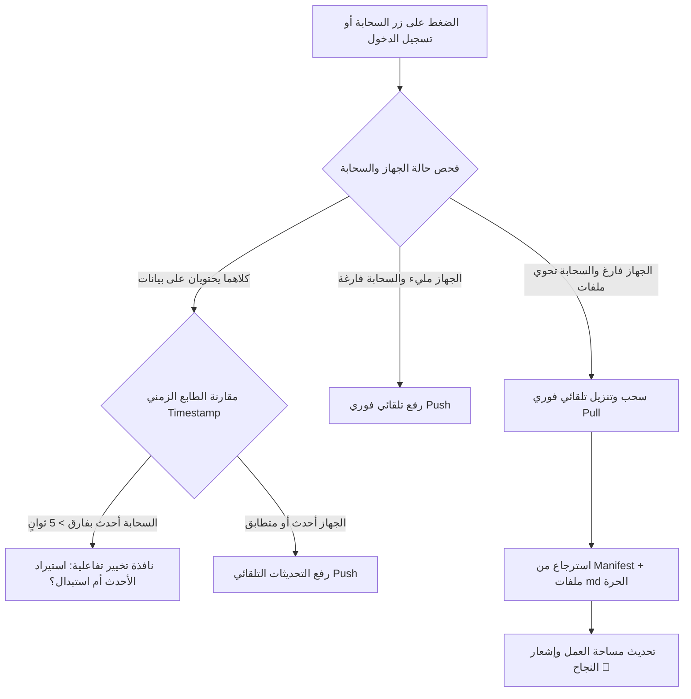

# السجل الهندسي الشامل لتطوير Vienix Markdown Editor
## من الفكرة المعمارية إلى المنظومة السحابية المتكاملة (التتمة والتوثيق المرجعي الكامل)

> **وثيقة مرجعية شاملة:** تجمع كافة المراحل والقرارات الهندسية، الأخطاء والمشاكل الواقعية التي واجهتنا، والحلول البرمجية الجذرية المطبقة وصولاً إلى النسخة الحالية المستقرة من محرر **Vienix Markdown Editor**.

---

## 📑 فهرس المحتويات العام

1. **مدخل وربط مع الأجزاء السابقة (الفصول 1 إلى 8)**
2. **الفصل 9: الإطلاق الميداني — تجهيز الدومين الفرعي ولوحة Vercel وتدشين Google Auth Platform**
3. **الفصل 10: بناء محرك Google Drive السحابي (المرحلة 2) ودمج الـ Client ID في صلب الكود**
4. **الفصل 11: الأزمة الأولى والخلل الحرج — تفريغ محتوى الحجرة 7 واستبداله بالافتراضي عند التحديث**
5. **الفصل 12: فك شفرة خطأ التفويض السحابي والـ GIS (`Error 400: origin_mismatch` وقيود الـ Audience)**
6. **الفصل 13: لغز سهم التنقل وانبثاق الملفات الشبحية (Ghost Files Bug) في المستكشف**
7. **الفصل 14: إصلاح منظومة حذف الملفات وتأمين نوافذ التأكيد من الارتداد (Event Bubbling Shield)**
8. **الفصل 15: إعادة هندسة شريط الحجرات — حل لخبطة الترتيب، إلغاء الحجرة 9، وتثبيت الحجرة 8 كعارض للمستكشف**
9. **الفصل 16: تكامل ميزة "لصق +" (Paste+) مع الحجرات والمستكشف الشجري**
10. **الفصل 17: التحول إلى المزامنة الذكية ثنائية الاتجاه (Smart Bi-directional Sync) وحل معضلة مزامنة الهاتف**
11. **الفصل 18: الدليل التقني لبنية النظام الحالي وخارطة الطريق**
12. **الفصل 19: ترقية محرك الحركات وعزل السجلات وتثبيت التمرير (Undo/Redo & Viewport Stabilization)**

---

## 🧭 مدخل وربط مع الأجزاء السابقة (خلاصة الفصول 1 - 8)

بدأت مسيرة تطوير التطبيق قبل عدة أيام بناءً على فلسفة **(Local-First + Personal Cloud)** بهدف تحرير محرر Vienix من قيد ذاكرة المتصفح المحدودة (`localStorage` ~5MB):
- **المرحلة 0 (الفصل 6):** بناء محرك الحماية الفوري [`storage-backup.js`](file:///c:/Users/Yaser/Mobiles-Apps/vienix-markdown-editor/app/js/storage-backup.js) بمؤشر صحة الذاكرة في شريط الحالة السفلي ودرع الحماية من امتلاء المساحة وكروت تصدير/استيراد بيئة العمل كملف JSON كامل.
- **المرحلة 1 (الفصل 7):** الانتقال المعماري إلى `IndexedDB` عبر محول [`vienix-idb.js`](file:///c:/Users/Yaser/Mobiles-Apps/vienix-markdown-editor/app/js/vienix-idb.js) بسعة تخزينية غير محدودة وكاش فوري في الذاكرة بزمن استجابة 0ms لمنع تجميد المتصفح.
- **المرحلة 2 - التأسيس (الفصل 8 - ملف 13):** وضع خريطة العمل لتجهيز الدومين الفرعي `vienixmarkdown.yaserhasan.at` على خوادم Vercel وإدارة DNS عبر easyname، مع إثبات الملكية في Google Search Console عبر Domain Property لتخطي متطلبات التحقق في Google Cloud.

توقف التدوين في الملف السابق عند السؤال عن نقطة الانطلاق في إعداد الـ DNS ولوحة تحكم Google Cloud Console. فيما يلي التتمة التوثيقية الشاملة لكل خطوة نُفذت بدقة.

---

## الفصل 9: الإطلاق الميداني — تجهيز الدومين الفرعي ولوحة Vercel وتدشين Google Auth Platform

### 1. ربط الدومين الفرعي على خوادم Vercel و DNS
- **إعداد Vercel:** تم الدخول إلى إعدادات المشروع في Vercel وإضافة الدومين الفرعي:
  `vienixmarkdown.yaserhasan.at`
- **إعداد مزود النطاق (easyname):** تمت إضافة سجل CNAME موجّه إلى:
  - **Name:** `vienixmarkdown`
  - **Type:** `CNAME`
  - **Target:** `cname.vercel-dns.com.`
- **شهادة الأمان:** أصدر Vercel شهادة SSL (HTTPS) تلقائية فور تفعيل السجل وأصبح الموقع يعمل مباشرة بنجاح.

### 2. ميزة النطاق الرئيسي في Google Search Console
لأن الدومين الرئيسي `yaserhasan.at` تم تأكيد ملكيته مسبقاً كـ **Domain Property** (سجل TXT)، اعتبرت Google الدومين الفرعي `vienixmarkdown.yaserhasan.at` موثقاً وتلقائياً ومملوكاً للمطور دون الحاجة لأي فحص يدوي إضافي.

### 3. تهيئة منصة Google Auth Platform (التصميم الحديث لـ Google Cloud)
في مشروع Google Cloud باسم **`vienixmarkdown`**:
1. **تفعيل Google Drive API:** من قسم Library تم البحث عن Google Drive API وتفعيلها.
2. **إعداد الهوية والمشروع (Project Configuration):**
   - **App Name:** `Vienix Markdown Editor`
   - **User Support Email:** البريد الشخصي.
   - **Audience:** تم اختيار **External** ليعمل مع حسابات Google العامة.
   - **Developer Contact:** إدخال البريد الإلكتروني للمطور.
3. **ضبط التوثيق والبراندينغ (Branding):**
   - **Authorized Domain:** تم إدخال `yaserhasan.at` وقبله النظام فوراً.
   - **روابط الصفحات القانونية:**
     - الصفحة الرئيسية: `https://vienixmarkdown.yaserhasan.at`
     - سياسة الخصوصية: `https://vienixmarkdown.yaserhasan.at/legal/privacy.html`
     - شروط الخدمة: `https://vienixmarkdown.yaserhasan.at/legal/terms.html`
4. **تحديد الصلاحيات الحساسة (Data Access / Scopes):**
   - بدلاً من طلب الوصول لكامل Google Drive، تم قصر الصلاحية على:
     `https://www.googleapis.com/auth/drive.file`
     *(صلاحية الوصول الحصري للملفات والمجلدات التي ينشئها المحرر فقط، مما يوفر أقصى حماية لخصوصية المستخدم وموافقة سهلة وسريعة من شاشات فحص Google).*
5. **إنشاء معرّف العميل (Web Client ID):**
   - نوع التطبيق: **Web Application**.
   - الاسم: `Vienix Markdown Editor Web Client`.
   - **Authorized JavaScript Origins:**
     - `https://vienixmarkdown.yaserhasan.at`
     - `http://localhost:5500` (للتطوير المحلي في أي وقت).
   - تم توليد الـ Client ID الرسمي المعتمد:
     ```text
     910465707186-ku2139v0blb6m9pkomehfc1dmdnp9lv5.apps.googleusercontent.com
     ```

---

## الفصل 10: بناء محرك Google Drive السحابي (المرحلة 2) ودمج الـ Client ID في صلب الكود

تم بناء المحرك السحابي المستقل بالكامل في ملف [`app/js/vienix-drive.js`](file:///c:/Users/Yaser/Mobiles-Apps/vienix-markdown-editor/app/js/vienix-drive.js) ليبقى معزولاً عن كود المحرر الرئيسي [`rtlmd.js`](file:///c:/Users/Yaser/Mobiles-Apps/vienix-markdown-editor/app/js/rtlmd.js).

### الميزات الأساسية للمحرك:
1. **دمج مكتبة GIS الحديثة:** تحميل `https://accounts.google.com/gsi/client` تلقائياً دون الحاجة لتضمين مكتبات خارجية ضخمة.
2. **المجلد السحابي المعزول (`Vienix Notes`):** يقوم المحرك عند أول اتصال بفحص Drive وإنشاء مجلد خاص باسم `Vienix Notes` لتوضع فيه كل الملفات.
3. **توليد ملفات Markdown حية مستقلة (`Chamber_*.md`):**
   - يتم رفع كل حجرة ومستند كملف `.md` مستقل يحمل رقم الحجرة واسمها (مثل: `Chamber_1_المقدمة.md`).
   - هذا يمنح المستخدم إمكانية فتح مستنداته وتعديلها عبر الهاتف أو تطبيق Obsidian أو VS Code مباشرة من Google Drive.
4. **ملف البيان الشامل (`vienix_workspace_manifest.json`):**
   - بالتوازي مع ملفات `.md`، يتم رفع ملف JSON جامع يحوي كافة الحجرات، المجلدات المخصصة، والميتاداتا لضمان استعادة بيئة العمل بنقرة واحدة بدقة 100%.
5. **تاريخ الإصدارات التلقائي (Automatic Versioning):** استخدام أسلوب `PATCH` على معرّفات الملفات الأصلية في Drive، مما يجعل Google Drive يحتفظ بتاريخ المراجعات القديمة مجاناً دون كتابة نظام Git يدوي.
6. **المزامنة الهادئة المؤجلة (Debounced Auto-Sync):** ضبط مؤقت المزامنة التلقائية ليعمل بعد دقيقتين من آخر تعديل، وذلك لتفادي استهلاك حصة الـ API اليومية (API Quotas).
7. **دمج الـ Client ID وتطهير الواجهة:**
   - تم دمج المعرّف `910465707186-ku2139v0blb6m9pkomehfc1dmdnp9lv5.apps.googleusercontent.com` داخل كود المحرك كقيمة افتراضية ثابتة.
   - إزالة حقول إدخال المعرف المشوشة من واجهة الإعدادات لجعل تجربة المستخدم فاخرة ونقية بزر اتصال بنقرة واحدة (1-Click Connect).

---

## الفصل 11: الأزمة الأولى والخلل الحرج — تفريغ محتوى الحجرة 7 واستبداله بالافتراضي عند التحديث

### 🚨 تفاصيل المشكلة المدوية:
أثناء العمل المكثف وكتابة نصوص حقيقية، تفاجأ المستخدم بعد تحديث الصفحة (F5 / Refresh) بأن محتوى الحجرة رقم 7 قد اختفى تماماً، واستُبدل بنص ترحيبي تجريبي افتراضي (`DEFAULT_INIT_CONTENT`)! تسبب هذا في استياء وغضب مبرر للمستخدم نظراً لخطورة فقدان البيانات.

### 🔍 التحليل الجذري للسبب (Root Cause Analysis):
عند الغوص في كود دالة `loadInitialContent()` داخل [`rtlmd.js`](file:///c:/Users/Yaser/Mobiles-Apps/vienix-markdown-editor/app/js/rtlmd.js)، تم اكتشاف "لغم برمجي" قديم موروث من مرحلة سابقة:
```javascript
// الكود المتسبب في الكارثة:
const isOutdatedOrEmpty = !saved || saved.trim().length < 160 || saved.indexOf('Pronunciation Assistant') === -1;
if (!isOutdatedOrEmpty) {
  editor.value = saved;
} else {
  // الكود كان يعتقد أن أي نص لا يحتوي على جملة مساعد النطق هو نص قديم ويجب استبداله!
  editor.value = DEFAULT_INIT_CONTENT;
  setChamberContent(activeChamber, DEFAULT_INIT_CONTENT);
}
```
**الأسباب المتداخلة للخلل:**
1. **الشرط القسري:** الكود كان يفترض أن أي نص يقل عن 160 حرفاً أو لا يحتوي على كلمة "Pronunciation Assistant" هو نص غير صالح ويجب محوه واستبداله بالنموذج التجريبي.
2. **سباق الذاكرة غير المتزامنة (Async IDB Race Condition):** لأن `IndexedDB` غير متزامن، كانت عمليات قراءة الحجرة في الأجزاء الأولى من الثانية تعيد `null` مؤقتاً قبل اكتمال `openDB`، فيقع المحرر في فخ مسح الحجرة فوراً وكتابة النص الافتراضي فيها.

### 🛠️ الحل الجذري المنفذ (Commit `e0c1b7f` - Commit 39):
1. **إلغاء فحص النص نهائياً:** تم حذف شرط `isOutdatedOrEmpty` بالكامل وبلا عودة.
2. **حصر النموذج التوضيحي بالزائر الجديد كلياً:**
   ```javascript
   // التحقق مما إذا كان التطبيق قد تم تشغيله سابقاً لدى الزائر
   const isAppInitialized = getStored('vienix_app_initialized', 'yaser_app_initialized') === 'true';

   if (!isAppInitialized) {
     safeSaveToStorage('vienix_app_initialized', 'true');
     safeSaveToStorage('yaser_app_initialized', 'true');
     // تحميل النموذج التوضيحي يتم حصراً لأول مرة فقط في الحجرة 1 إذا كانت فارغة تماماً
     if (activeChamber === 1 && (!saved || saved.trim().length === 0)) {
       editor.value = DEFAULT_INIT_CONTENT;
       setChamberContent(1, DEFAULT_INIT_CONTENT);
       renderMarkdown();
       finishInit();
       return;
     }
   }

   // في جميع الحالات الأخرى: محتوى الحجرة المحفوظ يُعرض كما هو بالكامل، ولا يتم مسحه أو استبداله أبداً
   editor.value = saved || '';
   renderMarkdown();
   finishInit();
   ```
3. **الترطيب الفوري للكاش (Instant Hydration):** إضافة دالة `VienixIDB.hydrateFromLocalStorage()` في [`vienix-idb.js`](file:///c:/Users/Yaser/Mobiles-Apps/vienix-markdown-editor/app/js/vienix-idb.js) لتعمل بصورة متزامنة فورية وتملأ `memoryCache` قبل رندرة أي سطر في المحرر (ضمان زمن وصول 0ms وعدم قراءة `null` مطلقاً).

---

## الفصل 12: فك شفرة خطأ التفويض السحابي والـ GIS (`Error 400: origin_mismatch` وقيود الـ Audience)

### 🚨 تفاصيل المشكلة:
عند تشغيل الموقع عبر الدومين الحي `https://vienixmarkdown.yaserhasan.at` والضغط على زر "تسجيل الدخول وربط Google Drive"، ظهرت نافذة Google المنبثقة محملة برسالة خطأ:
```text
Request details: access_type=online origin=https://vienixmarkdown.yaserhasan.at display=popup response_type=token ...
Error 400: origin_mismatch
```
أو إشعار بأن التطبيق محظور وغير متاح للمستخدمين.

### 🔍 التشخيص الدقيق:
1. **عدم تطابق الـ Origin المصرح به:** معرّف العميل يحتاج إلى مطابقة تامة للحروف بما فيها الـ Protocol `https://` وبدون شرطة مائلة إضافية في نهايته.
2. **اختناق وضع الاختبار (Testing Mode) في Google Cloud:** بما أن المشروع في حالة **Testing**، تشترط Google أن يكون أي إيميل يحاول تسجيل الدخول مسجلاً ومضافاً مسبقاً في قائمة **Test Users** داخل تبويب **Audience**.
3. **تضارب معاملات GIS:** طلب التوكن كان يرسل معاملات قديمة تخالف متطلبات Google Identity Services الصارمة.

### 🛠️ الحل الجذري المنفذ (Commit `4e21e8e` والضبط السحابي):
1. **تعديل كود [`vienix-drive.js`](file:///c:/Users/Yaser/Mobiles-Apps/vienix-markdown-editor/app/js/vienix-drive.js):**
   - مطابقة الـ Scope بدقة ليكون فقط: `https://www.googleapis.com/auth/drive.file`.
   - استخدام `prompt: 'consent'` لضمان فتح شاشة الموافقة الصريحة وتفادي الأخطاء الصامتة.
   - جلب بيانات البروفايل عبر طلب Drive About الرسمي:
     `https://www.googleapis.com/drive/v3/about?fields=user`
2. **ضبط إعدادات Google Cloud Console (تبويب Audience):**
   - تم التوجيه لإضافة الإيميل الشخصي للمطور ضمن **Test Users** أو تحويل التطبيق لوضع **Publish App (نشر التطبيق)** ليعمل مع أي مستخدم دون قيود.
3. **النتيجة:** نجح الاتصال فورياً، تحولت أيقونة السحابة إلى الأخضر المضيء 🟢، وظهرت صورة المستخدم وبياناته الشخصية وتم إنشاء مجلد `Vienix Notes` بنجاح على Google Drive.

---

## الفصل 13: لغز سهم التنقل وانبثاق الملفات الشبحية (Ghost Files Bug) في المستكشف

### 🚨 تفاصيل المشكلة:
اشتكى المستخدم من سلوك غريب وغير مرغوب فيه:
> *"هذا السهم يقوم بإنشاء ملفات جديدة بالمستكشف عند الضغط عليه وهذا لا يجوز.. هو عبارة عن سهم تنقل فقط!!"*

عند النقر على سهم التنقل `<` في شريط الحجرات، بدلاً من مجرد التبديل بين الحجرات الموجودة، كان النظام يقوم تلقائياً بإنشاء ملفات فارغة مجهولة وتكديسها في شجرة المستكشف تحت اسم "ملف جديد"، مسبباً تلوثاً وتراكماً لملفات وهمية (Ghost Files).

### 🔍 التشخيص البرمجي:
- كانت دالة التنقل تقرأ مصفوفة المعرفات عبر دالة تعيد أرقاماً متتالية تتجاوز الملفات الفعلية.
- عند محاولة التنقل لحجرة غير مفتوحة، كانت الدالة تستدعي منطقاً يقوم بحفظ سجل ملف فارغ في مفاتيح `vienix_folder_files_...`.
- تكرار النقر كان يولد ملفات متتالية 9، 10، 11، 12... دون أن تحتوي على أي نص.

### 🛠️ الحل الجذري المنفذ (Commit `9a1f76f` - Commit 56):
1. **قصر التنقل على الحجرات والملفات ذات المحتوى الفعلي فقط (Strictly Content-Only Navigation):**
   ```javascript
   function getCurrentNavigationChambers() {
     const seq = [1, 2, 3, 4, 5, 6, 7];
     try {
       const allFolders = getAppFolders();
       allFolders.forEach(folder => {
         const files = getFolderFiles(folder.key);
         if (Array.isArray(files)) {
           files.forEach(f => {
             // فقط الملفات التي تحتوي على محتوى مكتوب فعلياً — تجاهل الملفات الفارغة
             if (typeof f.num === 'number' && f.num >= 1 && !seq.includes(f.num)
                 && f.content && f.content.trim().length > 0) {
               seq.push(f.num);
             }
           });
         }
       });
     } catch (e) {}
     return seq;
   }
   ```
2. **منظومة الكنس التلقائي للملفات الشبحية (`cleanupDraftsAndExcessChambers`):**
   برمجة دالة صيانة ذكية تفحص مساحة العمل عند التشغيل وتقوم بحذف وتطهير أي ملفات فارغة كانت قد تولدت عن طريق الخطأ في الذاكرة المحلية، وتصحيح الترقيم التسلسلي تلقائياً.

---

## الفصل 14: إصلاح منظومة حذف الملفات وتأمين نوافذ التأكيد من الارتداد (Event Bubbling Shield)

### 🚨 تفاصيل المشكلة:
1. **فشل نافذة التأكيد:** عند محاولة حذف ملف من المستكشف، كانت نافذة التأكيد الحمراء (`confirm-action-modal`) تختفي فجأة بمجرد محاولة الضغط على زر "تأكيد الحذف"، أو تُغلق دون تنفيذ العملية.
2. **بقاء النصوص في الحجرة:** عند نجاح حذف ملف كان معروضاً في الحجرة 8 أو ما بعدها، كان السجل يُحذف من قائمة المستكشف لكن محتواه يظل عالقاً في الحجرة وفي شاشة المحرر دون تفريغ!

### 🔍 التشخيص البرمجي:
1. **ارتداد أحداث النقر (Event Bubbling):** كان عنصر الحاوية المعتمة (`modal-overlay`) يمتلك حدث `onclick="closeConfirmActionModal(event)"`، وبسبب ارتداد النقرة من أزرار النافذة الداخلية إلى الحاوية، كان المتصفح يفسر النقر على زر "تأكيد" كأنه نقر على الخلفية لإغلاق النافذة!
2. **عدم اكتمال دورة الحذف:** كود `deleteFolderFile` كان يقوم بتصفية مصفوفة الملفات فقط دون تفريغ مفاتيح الحجرة التابعة له في `IndexedDB` ودون إعادة ضبط الحجرة النشطة.

### 🛠️ الحل الجذري المنفذ (Commit `4a4a105` - Commit 57):
1. **حماية النافذة من الارتداد:**
   - إضافة `onclick="event.stopPropagation()"` على حاوية الحوار الداخلية (`chamber-modal-dialog`).
   - تحديث دالة `closeConfirmActionModal` بحيث تتأكد بدقة أن النقر كان على زر الإلغاء أو على الخلفية الخارجية حصراً.
2. **اكتمال عملية الحذف والتطهير الشامل:**
   ```javascript
   // تفريغ محتوى الحجرة بالكامل إذا كان الملف المحذوف معروضاً حالياً
   if (isViewingThisFile) {
     activeExplorerFile = null;
     try { localStorage.removeItem('vienix_active_explorer_file'); } catch (err) {}
     if (activeChamber >= 8) {
       setChamberContent(activeChamber, '');
       setChamberCustomTitle(activeChamber, '');
       activeChamber = 1; // العودة التلقائية للحجرة الآمنة الأولى
       safeSaveToStorage('vienix_active_chamber', 1);
       safeSaveToStorage('yaser_active_chamber', 1);
       const ch1Val = getChamberContent(1);
       if (editor) editor.value = ch1Val;
       renderMarkdown();
       updateStats();
     }
   }
   ```

---

## الفصل 15: إعادة هندسة شريط الحجرات — حل لخبطة الترتيب، إلغاء الحجرة 9، وتثبيت الحجرة 8 كعارض للمستكشف

### 🚨 تفاصيل المشاكل المعمارية في الحجرات:
1. **لخبطة ترتيب الأزرار:** لاحظ المستخدم ظهور الحجرة رقم 2 بعد الحجرة رقم 7 في الشريط العلوي (`1, 3, 4, 5, 6, 7, 2, 8`).
2. **انبثاق الحجرة 9:** عند تجاوز 7 ملفات، كان التطبيق يقوم بإنشاء أزرار لحجرات جديدة 9 و 10 مسبباً تشتتاً بصرياً وكسراً للتصميم.
3. **طلب المستخدم الحاسم والتوجيه الهندسي الصارم:**
   > *"الحجرات 1 إلى 7 هي حجرات النظام الأساسية الثابتة لعرض ملفات الكتاب.. والحجرة 8 هي المخصصة حصرياً لعرض ملفات المستكشف أو ما زاد عن 7.. لا أريد حجرة تاسعة تنبثق أبداً! وأريد دفع الحجرة الأخيرة لليسار قليلاً مع جعل سهم التنقل > فاصلاً ثابتاً دائماً في كل الوضعيات."*

### 🔍 التشخيص البرمجي:
- **سبب لخبطة الحجرة 2:** دالة `updateChambersUI` كانت تحاول إعادة استخدام عناصر DOM الموجودة (`getElementById`) بدلاً من مسحها، وعند الانتقال إلى وضع التجاوز كانت الحجرة 2 تُزال مؤقتاً، وعند الرجوع لا يجد الكود زر الحجرة 2 داخل `listEl` فيقوم بعمل `appendChild` له في النهاية، فيظهر بعد 7!
- **سبب انبثاق 9:** وجود معالجات أحداث في الخانة المتقطعة وسهم التقدم كانت ترفع قيمة `TOTAL_CHAMBERS` تلقائياً.

### 🛠️ الحل الجذري المنفذ (Commit `cac4c2f` و `1ade488` و `4a4a105`):
1. **إعادة بناء الـ DOM النظيف الصارم:**
   - في كل استدعاء لـ `updateChambersUI`، يتم تفريغ `listEl.innerHTML = ''` ورندرة الأزرار بالتسلسل الرياضي الصحيح `1, 2, 3, 4, 5, 6, 7` دون أي خطأ في الترتيب.
2. **الهندسة الثابتة لشريط الحجرات:**
   - الحجرات من 1 إلى 7 ثابتة في مكانها.
   - السهم `>` يظهر كفاصل أنيق ودائم.
   - **الحجرة 8 (عارض المستكشف):** أصبحت هي الحجرة الوحيدة المخصصة للمستكشف؛ عند النقر على أي ملف من المستكشف (مهما كان رقمه)، يُعرض محتواه داخل الحجرة 8 مع إظهار رقم الملف الفعلي وعنوانه الذكي المشتق من السطر الأول.
   - إلغاء إمكانية انبثاق أي حجرة 9 أو ما بعدها نهائياً.
   - إزاحة الحجرة الأخيرة إلى اليسار وتنسيقها بشكل جمالي متناسق مع النمطين الليلي والنهاري.

---

## الفصل 16: تكامل ميزة "لصق +" (Paste+) مع الحجرات والمستكشف الشجري

### التحدي الهندسي:
يمتلك المحرر ميزة فريدة وهي **"زر لصق + مع الكونتينر العائم"**؛ حيث يستطيع المستخدم نسخ أي نص من خارج التطبيق، والضغط على الزر العائم ليقوم المحرر تلقائياً بإنشاء ملف جديد في المجلد ولصق النص فيه مباشرة.
وكان السؤال الجوهري للمستخدم:
> *"هل راعيت التكامل التام بين ميزة لصق+ وبين المحرك الجديد والتخزين السحابي دون أن تضيع الملفات أو تتكرر؟"*

### ما تم تنفيذه للتكامل:
1. **الترقيم التسلسلي الذكي:** عند استخدام "لصق +"، يفحص المحرك أعلى رقم ملف موجود في المجلد وينشئ الملف التالي برقم تسلسلي دقيق، مع حفظه فوراً في `IndexedDB` وتوليد ميتاداتا تحوي عدد الكلمات والأحرف وتاريخ التعديل.
2. **العرض المباشر عبر الحجرة 8:** بمجرد إنشاء الملف ولصق المحتوى، يتم استدعاء `handleFolderFileClick` لفتح الملف الجديد مباشرة في الحجرة 8 دون مساس بالحجرات من 1 إلى 7.
3. **الجاهزية السحابية:** لأن الملف الجديد يُسجل في `vienix_folder_files_...`، يقوم محرك المزامنة التلقائية بالتقاطه وحفظه ضمن ملف البيان الشامل `vienix_workspace_manifest.json` على Google Drive تلقائياً.

---

## الفصل 17: التحول إلى المزامنة الذكية ثنائية الاتجاه (Smart Bi-directional Sync) وحل معضلة مزامنة الهاتف

### 🚨 تفاصيل المشكلة المعقدة:
بعد اكتمال بناء محرك المزامنة ونجاحه على جهاز الكمبيوتر؛ حيث قام المحرر بإنشاء مجلد `Vienix Notes` على Google Drive ورفع الحجرات وملف البيان بنجاح.
قام المستخدم بالدخول إلى الموقع من هاتفه المحمول وضغط على زر المزامنة، لكنه صُدم بأن **الهاتف بقي فارغاً تماماً ولم تظهر الملفات المكتوبة على الكمبيوتر!**

### 🔍 التشخيص الدقيق للمشكلة (لماذا لم تظهر ملفات الكمبيوتر على الهاتف؟):
1. **طبيعة الـ Local-First:** كل جهاز (الكمبيوتر والموبايل) يمتلك ذاكرة محلية منفصلة تماماً (`IndexedDB` محلي لكل متصفح).
2. **المزامنة الأحادية (Push Only):** كان زر السحابة ☁️ في الشريط العلوي مبرمجاً لاستدعاء دالة:
   ```javascript
   syncAllToDrive(); // رفع من الجهاز الحالي إلى Google Drive فقط
   ```
   عندما فتح المستخدم الهاتف لأول مرة، كان جهاز الهاتف فارغاً تماماً. فعند الضغط على "مزامنة"، قام التطبيق بـ **محاولة رفع بيانات الهاتف (الفارغة) إلى السحابة**، ولم يقم بطلب **سحب وتنزيل (Pull)** لملفات الكمبيوتر المخزنة على Drive!
3. **دفن زر التنزيل:** كانت ميزة سحب الملفات (`pullFromDrive`) موجودة فقط كزر يدوي معزول في قاع نافذة الإعدادات ولم تكن جزءاً من تجربة المزامنة التلقائية.

### 🛠️ الحل الجذري الشامل المنفذ (Commit `b3b88d2` - Commit 59):
تمت ترقية المحرك بالكامل من مجرد أداة رفع إلى **محرك مزامنة ذكي ثنائي الاتجاه (Smart Bi-directional Sync)**:



#### 1. التعرف التلقائي الذكي على الأجهزة الجديدة:
عند تسجيل الدخول لأول مرة من جهاز جديد (مثل الهاتف)، يفحص المحرك ذاكرة الجهاز تلقائياً؛ فإذا وجد أن الجهاز فارغ بينما حساب Google Drive يحوي ملفات سابقة، تنبثق فوراً نافذة ذكية:
> **«تم العثور على ملفاتك في Google Drive! ☁️📥»**  
> **«هل ترغب في استيراد وتنزيل ملفاتك إلى هذا الجهاز الآن؟»**  
> بمجرد الضغط على زر **(استيراد ملفاتي الآن)**، يتم تنزيل كافة الحجرات والمستندات وإعادة تنشيط المحرر فوراً.

#### 2. تحويل زر السحابة ☁️ إلى `smartSync`:
أصبح الزر العلوي وزر "مزامنة الآن" يقومان بوزن الحالة لحظياً:
- إن كان الجهاز فارغاً ➜ ينفذ السحب والتنزيل.
- إن كانت السحابة بحاجة لتحديث ➜ ينفذ الرفع.
- إن وُجد تعديل من جهازين في نفس الوقت ➜ يقارن الطابع الزمني؛ فإذا كانت السحابة أحدث يعرض للمستخدم نافذة احترافية توضح تاريخ النسخة الأحدث وتخيره بين جلب الأحدث من السحابة أو اعتماد نسخة الجهاز الحالي.

#### 3. درع الاسترداد متعدد الطبقات (Resilient Multi-Layer Recovery):
دالة الاستيراد لم تعد تعتمد على ملف البيان `vienix_workspace_manifest.json` وحده؛ بل أصبحت تفحص أيضاً ملفات الماركداون الحرة `Chamber_*.md` مباشرة من مجلد Drive، وتقرأ نصوصها وعناوينها كطبقة حماية إضافية تضمن عدم ضياع أي حرف حتى لو تعرض ملف البيان للتلف.

#### 4. الحفاظ الكامل على عناصر التحكم اليدوية:
تم الإبقاء على كافة الأزرار اليدوية داخل `الإعدادات > السحابة` (زر استيراد مساحة العمل اليدوي، زر المزامنة، ومفتاح تعطيل/تفعيل المزامنة التلقائية) كأدوات طوارئ احتياطية للمستخدم في أي وقت.

---

## الفصل 18: الدليل التقني النهائي لبنية النظام الحالي وخارطة الطريق المستقبلية

### 🏗️ خارطة المكونات البرمجية الحالية في تطبيق Vienix:

| الملف البرمجي | الدور المعماري | التقنيات والبروتوكولات |
|---|---|---|
| [`index.html`](file:///c:/Users/Yaser/Mobiles-Apps/vienix-markdown-editor/index.html) | الهيكل البصري، النوافذ، الأزرار، والصفحات القانونية | HTML5, Semantic, RTL Native, Dialog Modals |
| [`app/css/style.css`](file:///c:/Users/Yaser/Mobiles-Apps/vienix-markdown-editor/app/css/style.css) | التصميم الكامل، النمط الليلي/النهاري، وشريط الحجرات | CSS Variables, Responsive Design, Smooth Animations |
| [`app/js/rtlmd.js`](file:///c:/Users/Yaser/Mobiles-Apps/vienix-markdown-editor/app/js/rtlmd.js) | نواة المحرر، الرندرة، المحرر الكلاسيكي، المستكشف، والحجرات | Markdown, Mermaid, Prism.js, RTL Layouts |
| [`app/js/vienix-idb.js`](file:///c:/Users/Yaser/Mobiles-Apps/vienix-markdown-editor/app/js/vienix-idb.js) | طبقة التخزين المحلي فائق السرعة اللامحدود | IndexedDB API, Synchronous Memory Cache |
| [`app/js/storage-backup.js`](file:///c:/Users/Yaser/Mobiles-Apps/vienix-markdown-editor/app/js/storage-backup.js) | مؤشر صحة الذاكرة ومحرك التصدير والاستيراد JSON الشامل | Web Storage Analytics, JSON Snapshots |
| [`app/js/vienix-drive.js`](file:///c:/Users/Yaser/Mobiles-Apps/vienix-markdown-editor/app/js/vienix-drive.js) | محرك المزامنة السحابية الذكية ثنائية الاتجاه | Google Identity Services (GIS), Google Drive REST API v3 |

---

---

## الفصل 19: ترقية محرك الحركات وعزل السجلات وتثبيت التمرير (Undo/Redo & Viewport Stabilization)

### 🚨 تفاصيل التحدي الهندسي المزدوج:
1. **اتجاه الأسهم في البيئة العربية (RTL):**
   كان سهم التراجع يشير لليسار وسهم التقدم يشير لليمين، وهو نمط LTR المعكوس في تجربة القراءة والكتابة العربية، مما تطلب عكس الأسهم لتشير أيقونة التراجع (السابق) لليمين، وأيقونة التقدم (التالي) لليسار.
2. **عزل سجل الحركات بين الملفات والحجرات:**
   كان النظام يعتمد مصفوفة تراجع عالمية واحدة (`undoStack`)؛ وعند التنقل بين الحجرات كان يستدعي `initHistoryWithContent` مسبباً مسح السجل كاملاً، وفقدان حركات الملف السابق. وإذا لم يُمسح، كان التراجع في ملف يطبق نصوص ملف آخر!
3. **أزمة قفز الشاشة (Viewport Jump Bug):**
   عند التراجع أو التقدم بأسهم الشريط العائم، أو عند التنقل بين الملفات، كانت الشاشة تقفز فوراً للسطر الأول `scrollTop = 0` مسببة تشتتاً كبيراً للكاتب.

### 🔍 التشخيص البرمجي الدقيق لقفز الشاشة:
- عند استدعاء `editor.value = ...` و `renderMarkdown()`، كانت المعاينة `previewContent.innerHTML` تتفرغ للحظة وتصبح `scrollTop = 0`.
- التقط مستمع التمرير المتزامن (`handlePreviewScroll`) ذلك الصفر اللحظي واعتبره حركة من المستخدم، فقام بجر المحرر قسراً للسطر الأول.
- أمر `editor.focus()` التقليدي كان يحث المتصفح على القفز للأعلى.

### 🛠️ الحلول الجذرية المنفذة:
1. **عكس أيقونات الـ SVG بدقة:**
   - تعديل مسارات الـ SVG في [`index.html`](file:///c:/Users/Yaser/Mobiles-Apps/vienix-markdown-editor/index.html) في كل من وضع تقسيم الشاشة والوضع الكلاسيكي، ليصبح سهم التراجع متجهاً لليمين وسهم التقدم لليسار.
2. **المحرك المعزول للسجلات (`documentHistories`):**
   - توليد معرّف فريد لكل مستند: `chamber_1` إلى `chamber_7` للحجرات، و `file_{folderKey}_{fileId}` لملفات المستكشف (الحجرة 8).
   - حفظ واستدعاء سجل التراجع الخاص بكل ملف بدقة دون مسحه عند التنقل.
3. **تثبيت موضع التمرير واستعادة مكان القراءة (`documentScrollPositions`):**
   - حماية مستمعي التمرير بصمامات أمان: `if (isRestoringScroll || isPerformingHistory) return;`.
   - استخدام `focus({ preventScroll: true })`.
   - التقاط سكرول المحرر والمعاينة قبل التراجع/التقدم وتثبيتهما فوراً وفي `requestAnimationFrame`.
   - حفظ موضع السكرول والمؤشر لكل ملف مغادر واسترجاعه بدقة تامة فور العودة إليه.

---

## الفصل 20: الاستيراد المتطابق النظيف ومنع تسريب البيانات بين الحسابات السحابية (Clean Sync & Full Mirroring)

### 🚨 تفاصيل التحدي الهندسي المكتشف:
1. **تلوث البيانات وتسريبها بين الحسابات (Cross-Account Data Leakage):**
   عند تسجيل الدخول بحساب جيميل أول يحتوي 7 ملفات في السحابة على جهاز جوال، يتم تنزيل الحجرات من 1 إلى 7 وحفظها محلياً في ذاكرة الجهاز (`IndexedDB` و `localStorage`).
   وعند تسجيل الخروج ثم ربط حساب جيميل ثانٍ يحتوي على 5 ملفات فقط، كانت دالة الاستيراد القديمة تقوم بكتابة الحجرات 1 إلى 5 فقط فوق الذاكرة المحلية، **دون لمس أو تفريغ الحجرتين 6 و 7**.
   نتيجة لذلك: بقيت الحجرتان 6 و 7 من الحساب الأول عالقتين في الجهاز؛ وفي حال انطلقت المزامنة التلقائية (Auto-Sync) للحساب الثاني، كان التطبيق يرفع ملفات الحساب الأول داخل مجلد الحساب الثاني في Google Drive مسبباً تداخلاً خطيراً للبيانات.

2. **فحص فراغ مساحة العمل للجهاز الجديد (Fresh Device False Negative):**
   عند فتح الموقع لأول مرة على جهاز جوال جديد، يتم تحميل النص الترحيبي الافتراضي في الحجرة 1. كانت دالة `isLocalWorkspaceEmpty()` تفحص عدد الأحرف وتجده أكبر من صفر، مما كان يحرم الجوال الجديد من إظهار نافذة الاستيراد السحابي التلقائي فور ربط الحساب.

### 🛠️ الحلول الجذرية المنفذة:
1. **المطابقة السحابية النظيفة التامة (Full Mirroring Engine):**
   - ترقية دالة `applyRestore` في [`storage-backup.js`](file:///c:/Users/Yaser/Mobiles-Apps/vienix-markdown-editor/app/js/storage-backup.js) لتصبح `async`.
   - إجراء مسح شامل لجميع الحجرات من 1 إلى الحد الأقصى للحجرات:
     - إذا كانت الحجرة موجودة في السحابة/النسخة: يتم استعادتها وتحديث ميتاداتا العنوان والوقت.
     - إذا كانت الحجرة **غير موجودة** في السحابة (مثل الحجرات 6 و 7 و 8): يتم **تفريغها تماماً فوراً** ومسح ميتاداتا العنوان، لتعود كحجرة جديدة وفارغة تماماً مطابقة للسحابة 100%.
   - تنظيف وحذف أي ملفات مجلدات مستكشف قديمة (`vienix_folder_files_*`) لا تخص الحساب الجديد.
   - إعادة تعيين الحجرة النشطة افتراضياً إلى الحجرة 1 ومسح أي مؤشر لملف مستكشف قديم غير موجود.
   - انتظار اكتمال معاملات قاعدة البيانات `IndexedDB` غير المتزامنة (`await Promise.all(idbPromises)`) قبل إعادة تحميل الصفحة، لضمان عدم استرجاع المفاتيح المحذوفة من الذاكرة الوسيطة.

2. **التنظيف المحكم عند فصل الحساب (`disconnect`):**
   - في [`vienix-drive.js`](file:///c:/Users/Yaser/Mobiles-Apps/vienix-markdown-editor/app/js/vienix-drive.js): تفريغ معرّف مجلد السحابة القديم `appFolderId` ومسح `vienix_drive_folder_id` و `vienix_drive_last_sync` و `vienix_drive_connected_email` من الذاكرة المحلية، لضمان عدم محاولة الحساب الجديد استخدام مجلد الحساب السابق.
   - حفظ إيميل الحساب المتصل وتحديثه باستمرار.

3. **التعرف الذكي على الأجهزة الجديدة:**
   - تحديث `isLocalWorkspaceEmpty()` لتميز النص الترحيبي الافتراضي؛ فإذا كانت الحجرات الأخرى فارغة وتحتوي الحجرة 1 على النص الترحيبي فقط، يتعامل معها النظام كمساحة عمل جديدة نقية ويعرض نافذة استيراد ملفات السحابة فوراً بمجرد الربط.

---

## الفصل 21: محرك سجل التراجع المستمر الدائم (Persistent Undo/Redo Engine عبر IndexedDB)

### 🚨 تفاصيل التحدي الهندسي:
في جميع محررات الويب التقليدية، يتم حفظ سجل التراجع والتقدم (Undo/Redo) في الذاكرة المؤقتة (RAM) فقط.  
بمجرد إغلاق المتصفح، أو إعادة تحميل الصفحة (Refresh)، أو إطفاء الحاسوب، تفرغ الذاكرة المؤقتة تماماً، ويبدأ الكاتب بسجل تراجع فارغ؛ مما يمنعه من التراجع عن تعديلات أجراها قبل الإغلاق، أو استعادة نص قام بتصفيره بالخطأ إذا أُغلقت الجلسة.

### 🔍 المتطلبات المعمارية الدقيقة:
1. **الاستمرارية بعد انقطاع الطاقة أو إغلاق المتصفح (Persistent Across Sessions & Reboots):**
   الاحتفاظ بـ 60 حركة تراجع/تقدم لكل حجرة ومستند، واسترجاعها فورياً عند فتح المحرر.
2. **عزل `localStorage` عن تضخم البيانات (Quota Protection):**
   60 لقطة لنصوص كبيرة تستهلك ميجابايتات؛ ووضعها في `localStorage` (المحدودة بـ 5MB) كان سيفجر خطأ امتلاء الذاكرة (`QuotaExceededError`).
3. **عزل السحابة والنسخ الاحتياطي (Clean Cloud Isolation):**
   سجل التراجع هو بيانات محلية شخصية للمحرر؛ يجب ألا تتسرب لمجلد Google Drive أو لملفات الماركداون المنشورة.

### 🛠️ الحلول الجذرية المنفذة:
1. **التخزين في `IndexedDB` غير المحدودة (Persistent Engine):**
   - توليد مفاتيح دقيقة: `vienix_history_chamber_{ch}` للحجرات، و `vienix_history_file_{folderKey}_{fileId}` لملفات المستكشف.
   - حفظ الـ 60 حركة في `IndexedDB` بهدوء وبشكل غير متزامن عبر مؤقت تأخير ذكي (`schedulePersistHistory(docKey)` - Debounce 600ms).
   - استرجاع فوري من الذاكرة المهيأة `memoryCache` عند بدء التطبيق (`initApplication`) أو التبديل بين الحجرات دون أي بطء أو تجميد في واجهة المستخدم.
2. **صمامات الحماية الكاملة:**
   - تعديل [`vienix-idb.js`](file:///c:/Users/Yaser/Mobiles-Apps/vienix-markdown-editor/app/js/vienix-idb.js) لمنع كتابة أي مفتاح يبدأ بـ `vienix_history_` في `localStorage` نهائياً.
   - تعديل [`vienix-drive.js`](file:///c:/Users/Yaser/Mobiles-Apps/vienix-markdown-editor/app/js/vienix-drive.js) لاستثناء مفاتيح السجلات من حزم الـ Manifest المرفوعة للسحابة.
   - تعديل [`storage-backup.js`](file:///c:/Users/Yaser/Mobiles-Apps/vienix-markdown-editor/app/js/storage-backup.js) لمسح السجلات القديمة للحجرات المفرغة أثناء الاستيراد النظيف.
3. **أمان اللحظات الأخيرة (Lifecycle Hooks):**
   - حفظ فوري للسجل عند مغادرة المستند (`switchChamber` و `handleFolderFileClick`).
   - الاستماع لأحداث `beforeunload` و `pagehide` (للهواتف عند التبديل بين التطبيقات) لضمان عدم ضياع أي حركة حتى الثانية الأخيرة.

---

### 🌟 خلاصة الإنجاز الهندسي:
تحول تطبيق **Vienix Markdown Editor** خلال هذه الأيام القليلة من مجرد محرر نصوص محلي يعاني من خطر امتلاء الـ 5MB وفقدان البيانات الصامت إلى **منظومة كتابة وتدوين سحابية متكاملة تضاهي كبرى التطبيقات العالمية (مثل Obsidian Sync و Notion)**:
1. **ملكية مطلقة 100% للمستخدم:** بدون خوادم، بدون اشتراكات شهرية، وبدون أي وصول من المطور لبيانات المستخدمين.
2. **مناعة تامة ضد فقدان البيانات:** تخزين محلي غير محدود بـ `IndexedDB`، نسخ احتياطي يدوي فوري JSON، ومزامنة سحابية مؤرخة بالإصدارات التلقائية على Google Drive.
3. **سجل تراجع دائم ومستمر:** احتفاظ بحركات التراجع والتقدم لكل ملف حتى بعد إطفاء الكمبيوتر وإعادة تشغيله، مع أمان استرجاع كامل حتى بعد التصفير العرضي.
4. **مزامنة ذكية متعددة الأجهزة:** كتابة مقال أو فصل كتاب من الحاسوب في المنزل، ثم فتحه وتعديله أو استكماله من شاشة الهاتف أثناء التنقل بنقرة زر واحدة مع مطابقة نظيفة وعزل كامل بين الحسابات المختلفة.
5. **استقرار معماري وبصري:** تثبيت شريط الحجرات السبع وحماية الحجرة الثامنة كعارض مرن للمستكشف، وعزل سجلات الحركات وحفظ مواضع التمرير مع المحافظة على التنسيق العربي الأصيل من اليمين لليسار.

---
*تم بحمد الله توثيق كافة الخطوات، المشاكل، والحلول بدقة هندسية مطلقة لتكون مرجعك الدائم لتطبيق Vienix Markdown Editor.*


