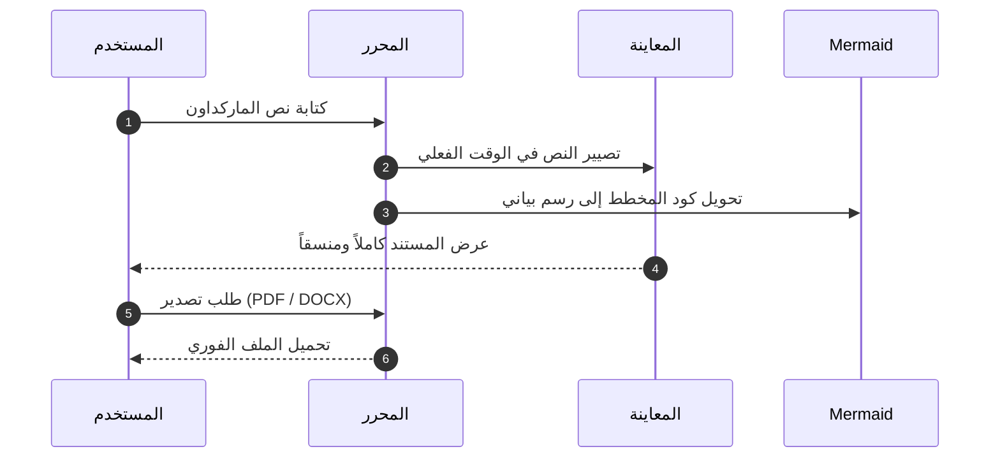

# مرحباً بك في Vienix Markdown Editor ✨

محرر ماركداون عربي احترافي وفائق السرعة، يدعم الكتابة من اليمين إلى اليسار (RTL)، والمخططات التفاعلية، والتصدير المباشر بصيغ متعددة.

---

## 📊 دعم المخططات والرسوم البيانية (Mermaid Diagrams)

يدعم المحرر مخططات **Mermaid** التفاعلية مباشرة داخل النص:

### 1. مخطط تدفق العمليات (Flowchart):

```mermaid
graph TD
    A[بداية الفكرة] --> B{هل تم التخطيط؟}
    B -- نعم --> C[كتابة المحتوى بالماركداون]
    B -- لا --> D[إعداد الأفكار والعناوين]
    D --> C
    C --> E[معاينة المخططات التفاعلية]
    E --> F[تصدير إلى PDF / Word / HTML]
    F --> G[نشر على الموقع بنجاح 🚀]
```


### 2. مخطط تسلسل الأحداث (Sequence Diagram):


---

## ⚡ الميزات وأزرار التحكم العلوية

- 📋 **أزرار النسخ (Copy)**: نسخ كود الماركداون أو كود HTML بضغطة زر واحدة.
- 📥 **أزرار التصدير (Export)**:
  - تصدير كملف **PDF** عالي الجودة يدعم اللغة العربية والمخططات.
  - تصدير كملف **Word (DOCX)** قابل للتعديل ومنسق من اليمين لليسار.
  - تصدير كصفحة ويب مستقلة **HTML**.
  - تنزيل ملف **Markdown (.md)**.
- 🎨 **المظهر الليلي والنهاري**: تبديل سلس ومريح للعينين.
- 💾 **حفظ تلقائي (Auto-Save)**: لا تفقد أي كلمة كتبتها أبداً.

---

## 📋 جدول مقارنة وخطة العمل

| الخاصية | المحرر القديم | Vienix Markdown Editor |
| :--- | :---: | :---: |
| **دعم المخططات (Mermaid)** | ❌ غير مدعوم | ✅ مدعوم بالكامل |
| **تصدير PDF و DOCX** | ❌ غير متوفر | ✅ نقرة زر واحدة |
| **دعم العمل بدون إنترنت** | ❌ يتطلب اتصال | ✅ يعمل بدون إنترنت 100% |
| **الخطوط والتصميم** | خط قديم وبسيط | ✅ خط تجوال (Tajawal) فاخر |

---

## 💻 تجربة الأكواد البرمجية (Code Highlighting)

```javascript
// دالة تصدير المستند
function exportDocument(format) {
    console.log(`جاري تجهيز المستند بصيغة: ${format}...`);
    // ميزة التصدير السريعة في Vienix Editor
    return true;
}
```

---

## 🔊 مساعد التدرب على نطق اللغات (Pronunciation Assistant)

يمكنك التدرب على نطق الكلمات والعبارات الأجنبية مباشرة من قسم المعاينة الحية. انقر على أي كلمة مفردة لسماع نطقها، أو انقر على أيقونة 🔊 لسماع العبارة كاملة:

- **الألمانية والنمساوية (Deutsch / Österreichisch 🇦🇹):**
  - Servus! Willkommen in Wien.
  - Das Wetter ist heute wunderschön und angenehm.
  - Guten Morgen allerseits! Wie geht es Ihnen?

- **اللغة الإنجليزية (English 🇬🇧 / 🇺🇸):**
  - Practice makes perfect when learning languages.
  - Clear pronunciation and natural speech synthesis.

> 💡 **تلميح**: يمكنك تخصيص لغة التعلم المستهدفة (مثلاً الألمانية النمساوية de-AT)، وتعديل سرعة النطق إلى وضع التدرب (0.75×) لسماع مخارج الحروف بدقة، أو اختيار صوت المتحدث من نافذة **الإعدادات ⚙️**.