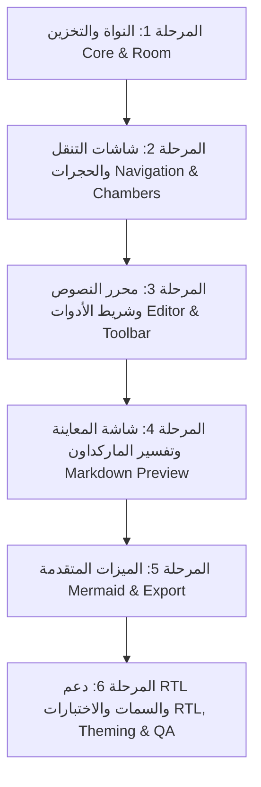

# خطة التحويل إلى تطبيق أندرويد (Mobile Migration Plan)

> توضح هذه الخطة المسار الهندسي لتحويل Vienix Markdown Editor من تطبيق ويب (Web SPA) إلى تطبيق Android أصيل (Native) بالكامل باستخدام **Kotlin** و **Jetpack Compose**.

---

## 1. الفلسفة الأساسية للتحويل (Core Migration Philosophy)

- **Native First**: يجب أن تكون كل التفاعلات الأساسية (الكتابة، إدارة القوائم، التصفح، شريط الأدوات، الإعدادات، وإدارة الملفات) عناصر أصلية (Jetpack Compose Composables) لتحقيق أعلى أداء وسلاسة ولمس واستجابة.
- **عزل المكونات المعقدة ذات الأصل الويب**: بعض الميزات مثل محرك Mermaid.js للمخططات البيانية تعتمد على كود JavaScript ضخم، وسيتم توضيح كيفية التعامل معها بكفاءة.

---

## 2. تصنيف المكونات (Native vs Hybrid/Special Handling)

### 2.1 مكونات يتم بناؤها كـ Native بالكامل (Pure Jetpack Compose):
1. **واجهة المحرر (Editor Screen)**:
   - استخدام `BasicTextField` مع `VisualTransformation` مخصص لدعم التلوين الصرفي للماركداون (Syntax Highlighting) أثناء الكتابة بدون بطء.
   - شريط أدوات التنسيق العائم (Floating Formatting Bar) فوق لوحة المفاتيح عبر `WindowInsets.ime`.
2. **إدارة الحجرات والمستندات (Chambers & Document Drawer)**:
   - قوائم Jetpack Compose `ModalNavigationDrawer` أو `LazyColumn` مع حركات سلسة وأزرار سريعة للفرز والتصفية.
3. **قاعدة البيانات والتخزين**:
   - `Room Database` للبيانات و `Jetpack DataStore Preferences` للإعدادات.
4. **شاشة الإعدادات ونوافذ الحوار**:
   - شاشات Composables كاملة مع حركات انتقال طبيعية في أندرويد.
5. **شريط الحالة وإحصاءات النص**:
   - مؤشرات نصوص `Row` أسفل الشاشة أو في شريط علوي خفيف.

### 2.2 مكونات تحتاج إلى معالجة خاصة أو WebView منعزل (Special Handling):
1. **مخططات Mermaid البيانية (Mermaid Diagrams)**:
   - **الخيار الأول (الأفضل والأخف)**: تشغيل محرك `mermaid.js` في بيئة WebView مخفية بالخلفية (Headless WebView) تقوم بتوليد كود SVG أو صورة وعرضها مباشرة داخل عنصر Compose `AsyncImage` أو مفسر SVG أصلي.
   - **الخيار الثاني**: استخدام مكتبات توليد المخططات البيانية الأصلية في كوتلن (مثل Graphviz Native) إذا توفرت بدائل مطابقة.
2. **المعاينة الغنية (Markdown Preview Screen)**:
   - يمكن استخدام مكتبة Jetpack Compose Markdown حديثة ومجربة مثل:
     - `com.github.jeziellago:compose-markdown`
     - أو مفسر CommonMark مع تحويل العقد إلى `AnnotatedString` ومكونات Compose أصلية (عناوين، جداول، اقتباسات، قوائم).
3. **تصدير الكتاب وملفات PDF/EPUB**:
   - **PDF**: استخدام `android.print.PrintManager` أو مكتبة `PdfDocument` في أندرويد لتوليد الصفحات وتنسيقها.
   - **EPUB**: استخدام مكتبة Kotlin لمعالجة ملفات Zip وملفات XML القياسية لـ EPUB.

---

## 3. مراحل التنفيذ التدريجية (Step-by-Step Roadmap)

### المرحلة 1: البنية التحتية ونظام التصميم (Core & Design System)
- إعداد نظام الألوان والخطوط العربية (Amiri, Cairo, Tajawal) كسمة `MaterialTheme` مخصصة.
- إعداد قاعدة بيانات Room والجداول الرئيسية والمستودعات (Repositories).

### المرحلة 2: محرك المحرر والتنسيق (Editor Engine)
- بناء محرك الماركداون التفاعلي في Compose وتطبيق قواعد الاتجاه العربي (RTL).
- ربط الحفظ التلقائي عبر `StateFlow` مع تأخير (Debounce).

### المرحلة 3: المعاينة والعرض المزدوج (Preview & Split/Tabs)
- على الشاشات الصغيرة (الهواتف): التبديل بين المحرر والمعاينة عبر Tabs أو زر تبديل سريع.
- على الشاشات الكبيرة (الأجهزة اللوحية والقابلة للطي Foldables): دعم العرض المنقسم (Split Screen) المشابه لنسخة سطح المكتب.

### المرحلة 4: الخدمات الخارجية والتصدير (Services & Exports)
- تصدير الملفات عبر Storage Access Framework.
- دعم Google Drive Sync عبر Google Drive REST API أو WorkManager.
